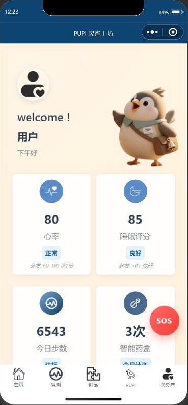
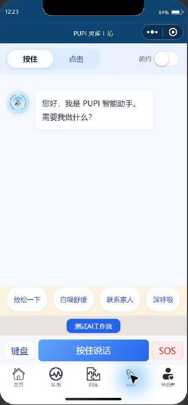
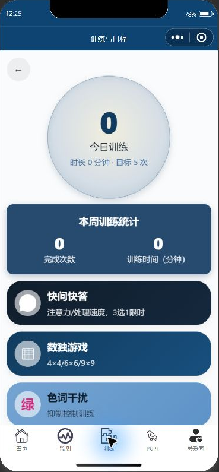
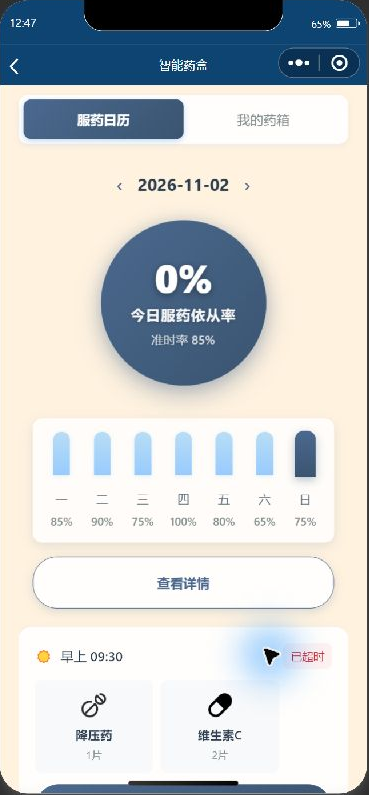
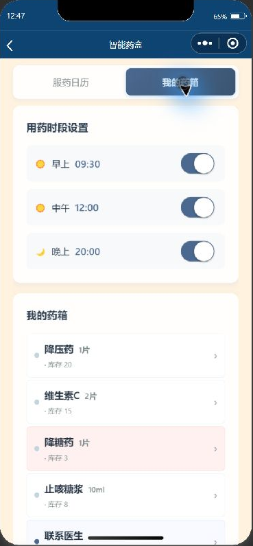
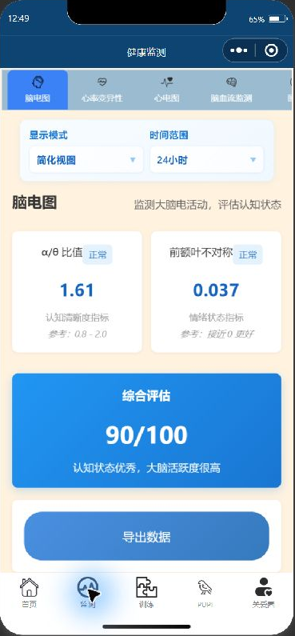

# PUPI demo walkthrough

The images in this repository were captured from the existing PUPI1102 project running in
WeChat Developer Tools on November 2, 2026. No live AI conversation or hardware voice loop
was tested during this capture.

## 1 Start with the home screen

The companion character and large cards establish an approachable starting point. Heart rate,
sleep, activity, and medication values in this development view are simulated. They are not
patient records or evidence of working medical sensing.

## 2 Open the conversation entry

The current screen exposes voice and keyboard entry, a simplified display, and quick actions.
The initial greeting is an interface message. This screenshot does not show an AI-generated
conversation or validate speech recognition, emergency contact, or relaxation outcomes.

## 3 Explore daily activities

The activity hub offers exercise entry points and local progress display. The capture shows
the menu and its initial state, not completed exercises or a clinical assessment.

## 4 Review medication routines and the home medicine cabinet

The two tabs show a medication calendar, example medication profiles and stock levels, time-slot
settings, and local confirmation-related views. Source files include `pages/medication/` and
`utils/medStore.js`. Current timing rules are simplified and some displayed percentages are
development values. This is not evidence of automatic adherence detection or physical dispensing.

## 5 Read the health-data interface

The overview and detailed-data module demonstrate information organization using simulated values.
No sensor feed, diagnostic function, medical result, or prediction accuracy was tested in this capture.

## What a partner demonstration could test next

- A short conversation with a controlled, synthetic scenario.
- Clear handling of a misunderstood or interrupted utterance.
- Audio transfer and playback on an actual connected device.
- Whether users understand when the system is listening and how to stop it.

These are proposed demonstrations, not results from the current screenshot session.
