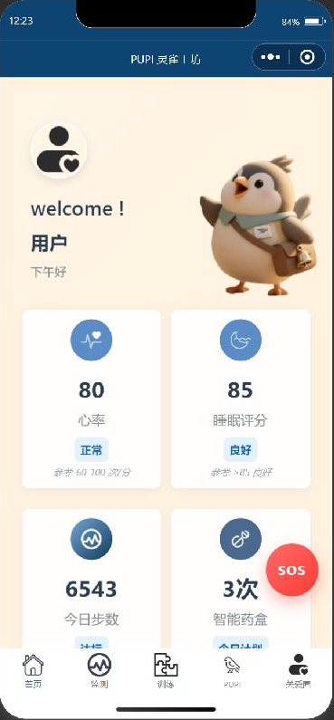
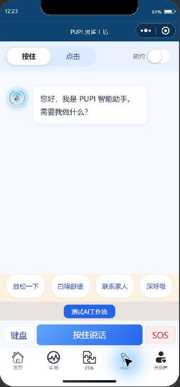
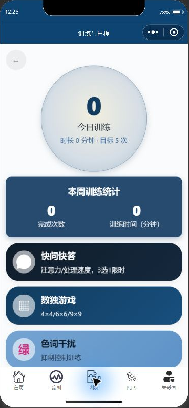
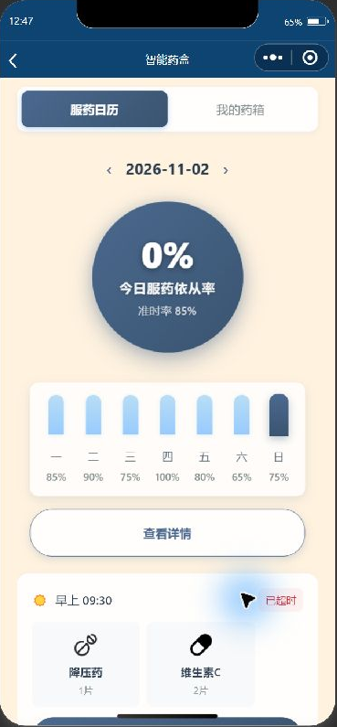
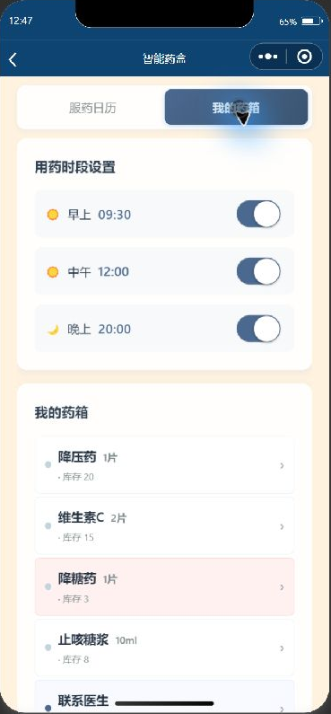
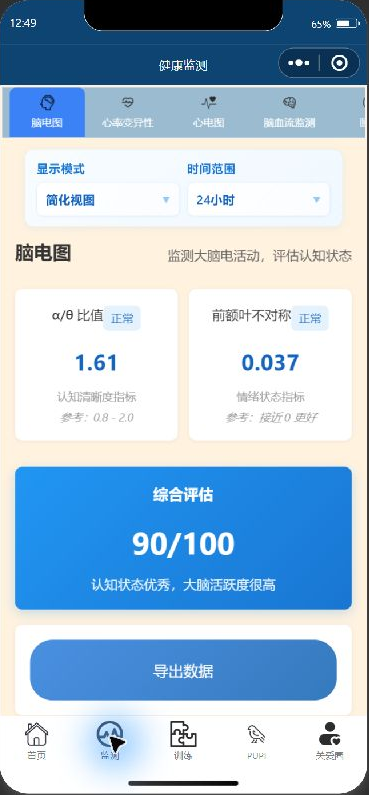

# PUPI

### A familiar voice. A warmer connection.

**Emotional companionship and everyday care at home.**

A WeChat mini-program connecting emotional companionship, a home medicine cabinet,
and readable health information, with a path toward voice-enabled companion devices.

[Explore the demo](DEMO.md) · [Business vision](BUSINESS.md) · [See the roadmap](ROADMAP.md) · [中文介绍](README.zh-CN.md)

**Interface demonstrated · Voice and device integration in development**

## A companion people can approach

PUPI starts with a simple idea: people should be able to ask for company in an ordinary,
comfortable way. A familiar character, an accessible conversation screen, and small daily
activities create different ways to begin an interaction.

The current software brings these ideas into a native WeChat mini-program alongside practical
household routines: a medicine cabinet, a medication calendar, daily activities, and health-data
views. The product vision is a companion that families return to both for conversation and
for help organizing everyday care. A small physical companion could extend that experience
beyond the phone.

## Inside the current experience

<table>
  <tr><th>A familiar starting point</th><th>An invitation to talk</th><th>A little daily engagement</th></tr>
  <tr>
    <td></td>
    <td></td>
    <td></td>
  </tr>
</table>

*Screens captured from the running project in WeChat Developer Tools on November 2, 2026.
Health and device values shown are simulated development data. The screenshots demonstrate
the interface; they do not establish connected-device performance or health outcomes.*

### Talk and be heard

The conversation screen offers a press-to-talk entry, keyboard input, a simplified mode,
and shortcuts for relaxation, breathing, and family contact. The source includes Coze
conversation and workflow integrations, contextual prompts, and fallback responses.
These give the project a concrete software base for exploring empathetic dialogue.

### Make room for everyday engagement

The mini-program includes an activity hub with memory and attention exercises, breathing-related
interaction, and local progress tracking. These are interaction and engagement features;
their therapeutic or cognitive effects have not been established.

### Keep the household medicine cabinet in view

The **home medicine cabinet** brings medication profiles, example stock levels, and configurable
time slots into one screen. A separate medication calendar shows schedules, user confirmations,
and local dose records. The intended value is to make a household routine easier to organize
and discuss with family members.

### Make health information easier to understand

PUPI includes a health overview and more detailed data views, alongside heart-rate, sleep,
activity, and medication cards on the home screen. These interfaces explore how information
design can help a family understand daily routines and choose when to check in.
The displayed sensor values are simulated; reliable sensing and predictive analytics are
future integration and validation work.

<table>
  <tr><th>Medication calendar</th><th>Home medicine cabinet</th><th>Health information</th></tr>
  <tr>
    <td></td>
    <td></td>
    <td></td>
  </tr>
</table>

*Actual development interfaces captured November 2, 2026. Medication entries and health values
are demonstration data. Software schedules and local confirmations do not establish physical
pill dispensing, automatic adherence detection, or validated medical monitoring.*

## The business vision

The initial customer hypothesis is a family that wants both companionship for an older adult
and a simpler way to organize everyday care. The older adult is the primary user. An adult
child may help choose, configure, or pay for the service.

PUPI's proposed route to market pairs its software with a companion-device or senior-service
partner. Potential revenue options include software licensing and optional family subscriptions
for personalized content and authorized summaries. A pilot should test repeat use, willingness
to pay, support demand, and service cost before pricing or scale commitments.

This is a proposed commercial direction, not a claim of paid users, sales, signed partnerships,
or proven health benefits. [Read the product and business rationale.](BUSINESS.md)

### Connect conversation to a physical companion

The project includes BLE communication modules, audio buffering and conversion utilities,
an Express backend, a cloud-function proxy, and ESP32 microphone/speaker firmware code.
They outline the connection between the mini-program and a voice-enabled device.
The complete device-to-speech-recognition-to-reply-playback loop still needs integration
and hardware validation.

## Development focus

This portfolio presents Zhixin Chen's work on PUPI's software and interaction layer:

- Native mini-program interfaces for conversation, daily activities, and device-facing workflows.
- Household medication organization and readable health-data interfaces.
- AI conversation and workflow integration, including context handling and fallback behavior.
- BLE/audio integration code and an ESP32 firmware starting point for physical interaction.
- Translating companionship scenarios into software flows that can be demonstrated and evaluated.

## What exists, and what comes next

| Area | Current evidence | Next step |
| --- | --- | --- |
| Mini-program experience | Home, conversation, and activity screens observed in the running developer-tool session | Device testing and accessibility review |
| Home medicine cabinet | Medication profiles, stock display, time-slot configuration, and calendar screens observed | Validate data entry, reminder delivery, synchronization, and household usability |
| Medication records | Local schedule and user-confirmation logic in the source | Validate timing rules and reporting before making adherence claims |
| Health information | Overview and detailed-data screens observed with simulated values | Connect reliable data sources and test whether users understand the summaries |
| AI dialogue | Conversation/workflow client code and contextual response logic are present | Repeatable evaluation of empathy, relevance, consistency, and safe responses |
| Voice interaction | Voice controls, recognition-related code, audio utilities, and backend scaffolding are present | Replace simulated paths and validate the complete speech pipeline |
| Physical integration | BLE handlers and ESP32 microphone/speaker firmware code are present | Test transfer reliability, playback, interruption, and recovery on hardware |
| Predictive analytics | Future product direction | Establish reliable data and evaluate a defined prediction task before claiming results |
| Companion robotics | Software-to-device integration concept | Co-develop a physical companion experience with hardware partners |

## A path toward companion robotics

PUPI is being shaped around capabilities relevant to older-adult companion robots and small,
approachable emotional-companion devices: supportive dialogue, voice interaction, visible
device states, and simple ways to pause or leave an interaction.

The opportunity is to connect those software capabilities with a physical presence. The next
stage is a measured progression: improve the conversation, complete the voice loop, integrate
a device, and evaluate the experience with users. [Read the roadmap.](ROADMAP.md)

## Engineering foundation

**Native WeChat mini-program · JavaScript · WXML/WXSS · Coze integrations · Node.js/Express · BLE · ESP32/I2S**

This repository contains presentation material and selected screenshots. Application source,
runtime credentials, and internal development notes are maintained in a separate private repository.
No clinical validation, production hardware deployment, or university partnership is claimed here.

---

Project portfolio: [Zhixin Chen](https://github.com/KimChen001)
