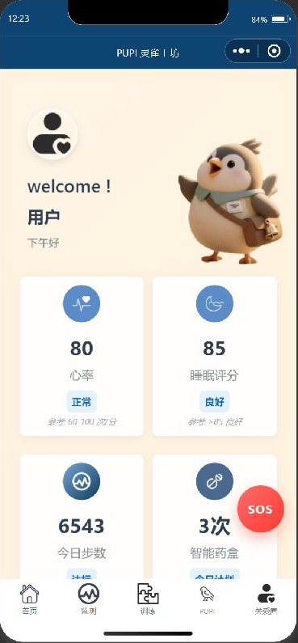
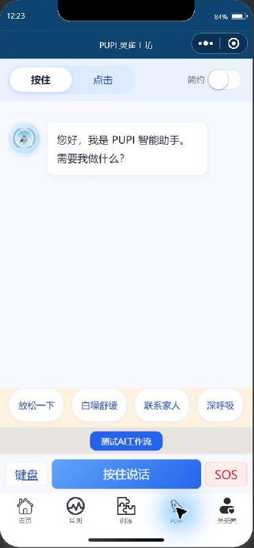
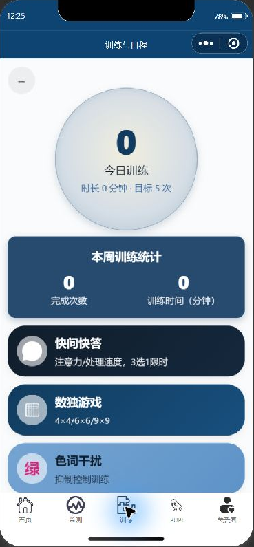
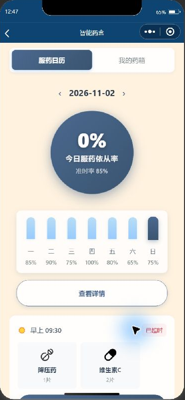
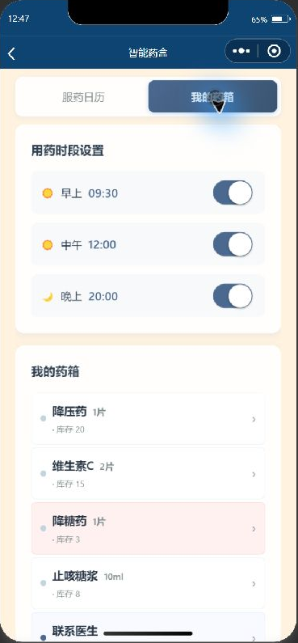
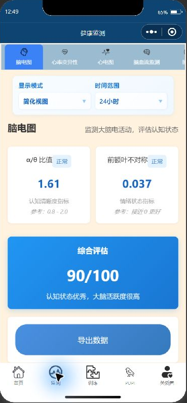

# PUPI

**熟悉的声音，多一点陪伴。**

PUPI 从微信小程序出发，将老年人的情感陪伴、家庭药箱和健康信息放进一个日常使用场景。
我们希望把一个容易接近、愿意倾听，也能帮助家庭组织日常照护的服务，逐步带到实体陪伴设备上。

[English](README.md) · [实际界面演示](DEMO.md) · [商业愿景](BUSINESS.md) · [发展路线](ROADMAP.md)

## 当前可以看到的体验

| 首页与陪伴入口 | 对话入口 | 日常训练 |
| --- | --- | --- |
|  |  |  |

以上是 2026 年 11 月 2 日在微信开发者工具中截取的真实项目界面。
健康指标与设备读数为开发模拟数据；截图不代表医疗监测、情绪改善或硬件联调已经验证。

## 这份项目展示的技术工作

- 微信原生小程序中的对话、日常活动与设备交互界面。
- Coze 对话及工作流接入、上下文处理与兜底回复逻辑。
- BLE 通信、音频处理与 ESP32 麦克风和扬声器固件代码。
- 将情感陪伴场景转化为能够演示和继续验证的软件交互流程。

## 家庭药箱与健康数据

家庭药箱已有药物档案、库存显示、用药时段设置和服药日历界面，源码包含本地服药计划与确认记录。
健康模块已有概览及详细数据视图，帮助展示“怎样把信息组织得更容易理解”。当前健康指标为模拟数据，
不代表已接通真实传感器或验证了医疗监测效果；软件确认记录也不能证明实际服药或物理药盒出药。

| 服药日历 | 我的药箱 | 健康信息 |
| --- | --- | --- |
|  |  |  |

## 商业上的产品逻辑

情感陪伴提供交流的理由，药箱管理与日常信息提供持续使用的实际场景。
首期假设是服务有陪伴与日常照护协调需求的老年家庭，长者是主要使用者，成年子女可能参与选择、设置或付费。

拟探索与陪伴设备或养老服务伙伴合作，通过软件授权、可选家庭订阅或限定范围的试点项目验证商业可行性。
下一步需要核实重复使用、付费意愿、支持成本与软硬件协同价值，不将规划写成已有订单、收入或合作协议。

这也是 PUPI 可以展示的商业与系统设计工作：界定用户与付费方，把需求组织成可实现的功能，
再用试点决定产品、渠道与服务模式。[商业愿景与验证问题](BUSINESS.md)

## 与陪伴机器人的连接

PUPI 的下一阶段重点是共情式对话、完整语音闭环与实体设备接入。
这些能力可用于探索老年陪伴机器人以及小型情绪陪伴设备的交互体验。

当前已有对话界面与设备接入代码基础，但后端及语音链路仍包含未完成或模拟路径。
后续需要完成语音识别、回复播放、中断退出与真实硬件联调，再开展适当的用户体验验证。

本仓库展示现有工作与未来方向，不将规划写成已交付成果，不宣称临床效果、量产部署或正式高校合作。
源码和内部运行材料单独保存在私有仓库。

项目作品集：[Zhixin Chen](https://github.com/KimChen001)
